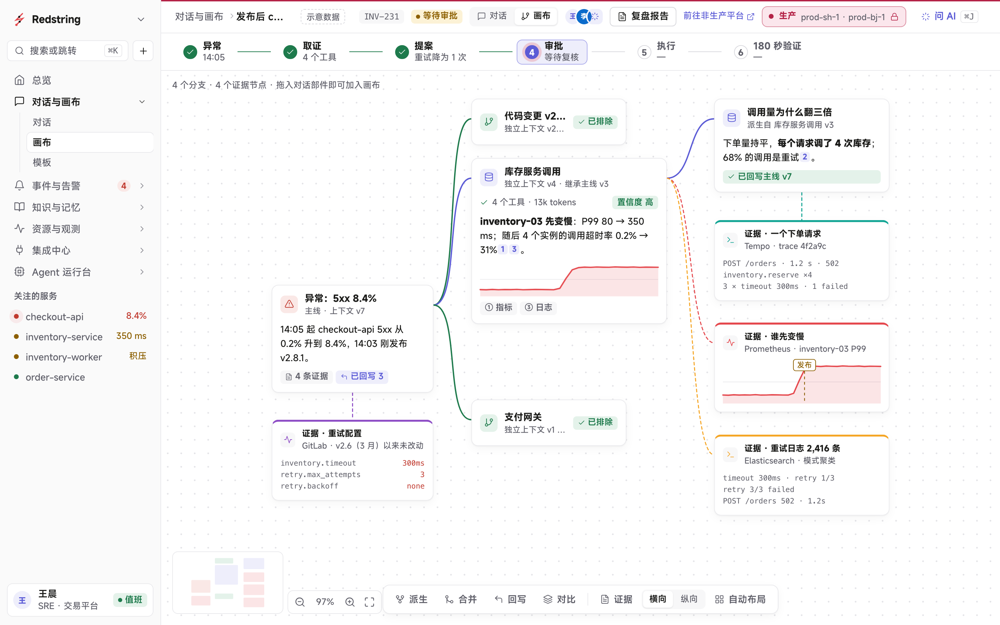

<picture>
  <source media="(prefers-color-scheme: dark)" srcset="docs/brand/redstring-mark-on-dark.svg">
  
</picture>

# Redstring

Redstring 是一个可自托管的 AI 运维工作区。AI 可以查询运维数据、沿不同假设分头取证，并给出带证据的结论和回滚建议。团队在画布上核对证据，由有权限的人员批准恢复操作。

[在线演示](https://redstring.wans.run/)（示例数据） · [本地试用](#快速开始) · [产品介绍](https://wans.run/redstring/)



<sub>截图来自在线演示，使用示例数据。</sub>

## AI 核心能力

- **用自然语言查询运维数据**。例如问「checkout-api 最近 15 分钟的 5xx 比例是多少，有哪些典型报错？」AI 通过已配置的只读工具查询指标和脱敏日志样本，读取范围受应用、环境和用户权限约束。
- **分支调查与上下文隔离**。调查者可以为新版本、下游依赖、资源压力等假设分别创建分支。每条分支从父分支的指定版本继承上下文，后续提问和 AI 取证都在各自分支内进行。
- **检索团队运维知识**。对话和调查都可以检索有权访问的已发布 Runbook 和知识文档，把团队已有的排查手册与本次故障证据放在一起参考。
- **引用证据与回写结论**。AI 回复中的引用可以打开对应的指标、日志样本或知识来源。调查者先预览，再选择将结论摘要、消息原文或证据写回主线。
- **提供可审阅的回滚建议**。读取已登记的 Kubernetes 工作负载和候选修订后，AI 可以建议目标修订，并列出理由和证据引用。由值班人员核对建议、发起提案，获得批准后交给独立执行器。
- **配置模型与工具**。可接入本地 Ollama 或 OpenAI 兼容接口，按环境配置模型。取证工具由服务端启用，管理员可在集成中心登记 MCP 服务并逐项审核发现的工具。

## 核心工作流

以一次新版本发布后 HTTP 5xx 比例升高为例。

1. **从告警发起调查**。值班人员确认受影响的服务、环境和告警时间，从告警组或事件创建调查画布。
2. **分头取证**。值班人员分别追问「这次发布换了哪个镜像？」和「错误日志里有没有下游超时？」AI 在各分支查询已接入的数据，给出初步结论与对应证据。
3. **核对并汇总结论**。值班人员对照错误率、日志和发布变更，筛出能解释异常的线索，把确认的结论和证据回写主线。
4. **审阅回滚建议并提案**。值班人员核对 AI 建议的目标修订和变更内容，提交回滚提案。发起人之外的两位授权成员用通行密钥批准同一份提案，再由独立执行器执行回滚。
5. **验证恢复**。执行器等待滚动更新完成，再在观察窗口内检查请求率、错误率和样本时效。团队可以在执行详情查看进度、采样记录和验证结果，并据此准备复盘。

## 工作区

- **服务与观测**。按应用和环境查看服务目录、资源依赖和 SLO 信号。结合指标趋势、日志样本和调用链路，查看同一时段的服务表现。
- **告警与事件**。认领告警、跟进事件状态。在事件详情查看告警前后的 GitLab 部署和 Kubernetes 修订，作为排查线索。
- **变更与执行**。查看已接入的部署记录和提交差异，核对可回滚的修订。执行详情保留审批、滚动进度和恢复验证结果。
- **Runbook 与复盘**。维护、审核和检索排查手册，为已解决的事件记录影响、根因和行动项。已发布的复盘可以作为新 Runbook 的起点。
- **集成与权限**。可接入 Kubernetes、Prometheus、Loki、Tempo、Alertmanager 和 GitLab。按环境配置数据源和模型，按角色及应用范围授权。

## 快速开始

在本地预览示例工作区，只需 Git、Node.js、pnpm 和 `make`。

```sh
git clone https://github.com/destinywans/redstring.git
cd redstring
pnpm --dir web install --frozen-lockfile
make web-dev
```

打开 [http://127.0.0.1:5173](http://127.0.0.1:5173)。要启动后端并接入自己的测试数据，请按[自托管指南](docs/getting-started.md#本机完整运行最小实例)配置。

## 文档

[架构说明](docs/architecture.md) · [AI 取证](docs/api/v3-investigation-evidence-tools.md) · [模型接入](docs/getting-started.md#模型) · [API 参考](docs/api-contract.md)

## 安全须知

Beta 版本仅供测试环境试用，请勿暴露到公网。配置了写权限的模块可以修改外部系统，请只使用测试凭据。AI 取证会将选用的证据发送给你配置的模型。

## 反馈

[提交缺陷](https://github.com/destinywans/redstring/issues/new/choose) · [私密报告安全漏洞](SECURITY.md)

## 许可证

[Apache-2.0](LICENSE) · [第三方许可](THIRD_PARTY_NOTICES.md)
