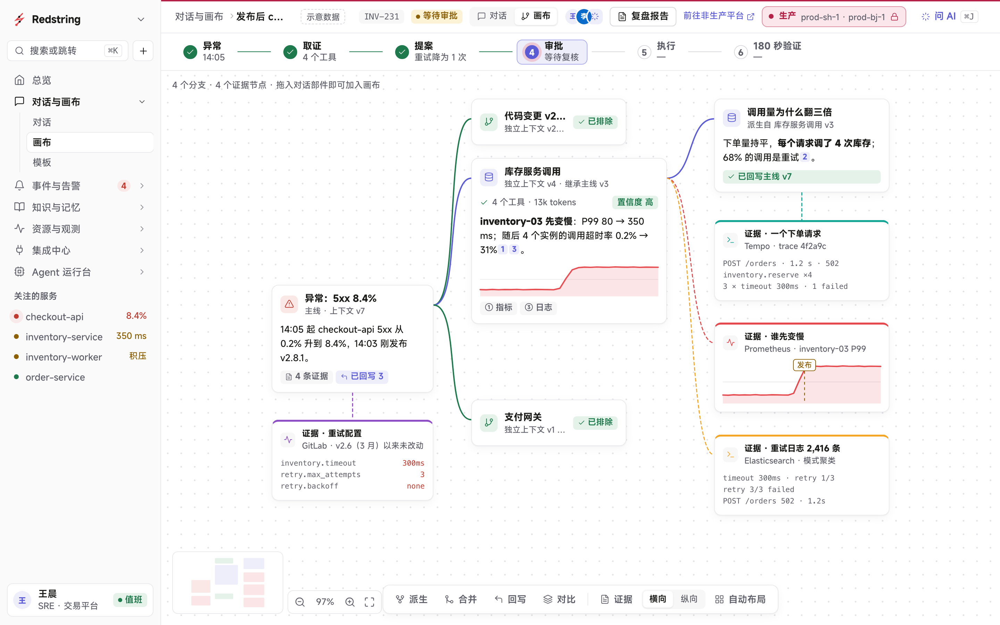

<picture>
  <source media="(prefers-color-scheme: dark)" srcset="docs/brand/redstring-mark-on-dark.svg">
  
</picture>

# Redstring

**让 AI 分头调查，由人来批准。** 可自托管的 AI 运维工作区：故障调查在画布上分支进行，证据都有出处，线上变更要人批准一份具体的提案，再交给独立执行器执行并验证恢复。

[在线演示](https://redstring.wans.run/)（示例数据） · [产品页](https://wans.run/redstring/) · [Linear 项目](https://linear.app/wansss/project/redstring-3c9fce50a53b)

> **状态：v0.1.0 beta，不建议用于生产环境。** 作为 MVP 和实验环境演示可用，尚未达到生产可用，差距见下方[「还没做」](#还没做)；已知问题见 [docs/KNOWN_ISSUES.md](docs/KNOWN_ISSUES.md)。执行器会对接入的系统做写操作，只接测试环境，先读[「安全须知」](#安全须知)。



<sub>截图来自在线演示，使用示例数据。</sub>

## 它能做什么

三个核心设计：

- **分支调查**：每个怀疑派生成一条分支，从父分支的某个上下文版本继承，之后独立取证；排除的分支留下理由，确认的结论经合并预览写回主线，过期的预览不能覆盖更新的版本。
- **证据有出处**：取证工具只读，结论带引用，能追到背后的工具调用、检索结果和 Trace。模型的猜测不算证据。
- **批准与执行分开**：批准绑定一份冻结的提案；执行交给与 Agent 隔离的执行器，结果不明时先核对实际状态，不盲目重试；恢复后持续观察 180 秒再判定。

围绕这条主线的工作区：

| 模块 | 内容 |
| --- | --- |
| 总览 | 关注的服务、待办和 AI 入口 |
| 对话与画布 | 对话和画布两种模式，共用富消息渲染 |
| 事件与告警 | 告警、事件、静默、路由、告警规则（经执行器启停）、复盘 |
| 知识与记忆 | Runbook、知识源、调查经验；混合检索 |
| 资源与观测 | 服务目录、资源关系、指标、日志、链路 |
| 交付 | 变更与发布、回滚、跨环境配置提升，均走人工审批 |
| 集成中心 | Kubernetes、Prometheus、Loki、Alertmanager、GitLab、Elasticsearch、Tempo 等连接器 |
| 平台设置 | 成员、角色权限、模型与 Embedding、生产与非生产实例隔离 |

界面支持中英文和深浅色。

## 当前状态

测试环境是三台 Lima 虚拟机上的 Kubernetes 实验集群，配合实验 GitLab、Prometheus、Loki、Alertmanager、Elasticsearch、Tempo、Vault，以及一生产一非生产两个独立实例。做过两轮：

1. **生产验收**（2026-10-09～10-12）：按页面、角色、演练逐项验收，登记缺陷 PA-01～PA-104。
2. **缺陷收敛**（2026-10-16～10-19）：每天一轮值班，轮流做故障演练、角色任务卡、数据状态和自由探索，并按类清扫同类问题。登记 PA-105～PA-247 共 143 条：P0 26、P1 16、P2 56、P3 38、缺能力 7（按登记册里不重复的编号计）。**P0/P1 全部修复并部署**（f91966ed）；未修 P2 6 条、P3 3 条、缺能力 7 条，见 [已知问题](docs/KNOWN_ISSUES.md)。

发布验收轮（第 3 轮，含会话到期、写凭据失效、告警时间、浏览器时钟四项时间注入演练）的结论：_待第 3 轮收工后填写。_

### 已验证

- **发布演练**：在生产实例上从坏版本上线到回滚、修复全程走通（2026-10-12，第 2 轮 24/24）。
- **告警规则闭环**：经人工审批合并到配置仓库，执行器加载并读回，启用与停用都验证过（2026-10-12）。
- **配置提升**：四类配置从非生产导出，经审批合并后在生产导入（2026-10-12）。
- **生产验收最终回归 19/19（2026-10-12）**：全页面对拍 216 次加载，0 未捕获异常，0 空白页；两个实例的权限矩阵 138 条路由无不一致；登录、凭据、环境隔离等专项全部通过。
- 生产验收登记的 104 项缺陷（PA-01～PA-104）全部验证：绝大多数已修复，少数转入后续或经决定保留现状（仍有影响的列在已知问题里）。
- **缺陷收敛**：每条修复先写检查、在旧部署上确认失败，修复部署后通过，并在真实数据上核对；f91966ed 部署后的完整回归 47/49，两项未过分别是回滚写令牌按设计 24 小时到期、一条检查的按钮定位写法过时（修正后通过）。
- **v0.1.0 最终回归**：_待 G3 完成后填写（版本、通过数、日期）。_

详见 [验收登记](docs/releases/2026-10-09-production-acceptance.md)、[缺陷收敛登记](docs/releases/2026-10-16-defect-convergence.md) 和 [v0.1.0 发布说明](docs/releases/v0.1.0.md)。

### 还没做

- **生产可用性认证暂缓**：原计划以连续多日无新 P0/P1 作为生产可用的标准，v0.1 改为发布门槛，这项认证以后再做。
- **性能与 24 小时稳定性**。
- **环境广度**：只验过一个实验集群、三个服务、单机单进程；大数据量、多副本部署、其他版本的 GitLab/Prometheus 未验证；模型只验过 DeepSeek。
- **安全**：登录二次验证未做，没有独立安全审查。
- **运维**：备份恢复、升级迁移、自身监控告警未验收，凭据轮换靠手工。

多租户、SSO、长会话自动摘要和完整 CI/CD 不在当前范围；存储默认 PostgreSQL + pgvector，其他向量库尚未实现。

## 安全须知

- **只接测试环境。** 提案经人批准后，独立执行器会对接入的系统做写操作：Kubernetes 回滚（改 Deployment）、Alertmanager 静默、经配置仓库合并的告警规则启停、跨环境配置导入。不要接入生产集群、生产 Alertmanager 或生产配置仓库。
- **不要暴露到公网。** 没有做过独立安全审查，登录没有二次验证。默认只监听本机（`.env` 的 `AIOPS_ADDR=127.0.0.1:8080`，Docker Compose 也只映射回环地址）；改监听地址前先想清楚谁能访问。
- **默认开发配置不是 HTTPS。** `AIOPS_SECURE_COOKIES` 默认未开启，会话 Cookie 在 HTTP 下也会发送。放到服务器上要加 HTTPS 反向代理，并设置 `AIOPS_PUBLIC_ORIGIN` 与 `AIOPS_SECURE_COOKIES=true`，见 [运行与部署](docs/getting-started.md)。
- **证据会发给模型。** AI 取证会把指标、脱敏后的日志正文等发给你配置的模型；用外部模型服务（如 DeepSeek）前，确认这些数据可以发出去。
- 凭据只放在服务端；`.env`、kubeconfig、令牌文件不要提交。安全问题请按 [SECURITY.md](SECURITY.md) 私密报告，不要公开提 issue。

## 快速开始

只看界面（示例数据，不需要后端）：

```sh
pnpm --dir web install --frozen-lockfile
make web-dev
```

本机完整运行（需要 Go、Node、pnpm、Docker Compose）：

```sh
make init db
pnpm --dir web install --frozen-lockfile
make web-api                      # 终端 1
VITE_API_MODE=http make web-dev   # 终端 2
```

浏览器打开 http://127.0.0.1:5173。管理员账号和密码在 `make init` 生成的 `.env` 里。

构建后由 Go 托管：

```sh
make web-build
AIOPS_WEB_DIR="$PWD/web/dist" make run
```

两种前端模式、地址约定、Docker Compose 和部署注意事项见 [运行与部署](docs/getting-started.md)。

## 架构

PostgreSQL 里的消息、证据、版本和事件是唯一的权威历史；每次推理用独立的 ADK Session，从冻结的上下文构造输入，换模型不改写历史。流式事件带序号，断线后从已提交的位置续读。业务仓储、向量、Embedding、模型和连接器分别适配；模型支持 Ollama、OpenAI 兼容接口（如 DeepSeek）和 Claude，见 [模型说明](internal/inference/README.md)。授权和同源校验在服务端完成。

React · TypeScript · Vite · React Flow · assistant-ui · Go 1.27.1 · Google ADK Go 2.4.0 · PostgreSQL 17 + pgvector 0.8.6

## 文档

[架构](docs/architecture.md) · [Web 工作区](docs/web-workspace.md) · [API 语义](docs/api-contract.md) · [OpenAPI 3.1](internal/apicontract/openapi.json) · [领域语言](CONTEXT.md) · [计划](PLAN.md) · [检查点](CHECKPOINT.md) · [故障演示环境](docs/demo.md)

原名 AIOps Canvas，2026-10-09 起更名为 Redstring；代码中的模块名、命令和接口路径保持不变。标志与使用规范见 [docs/brand](docs/brand/README.md)。

## 反馈

欢迎试用后提 [GitHub issue](../../issues)。先看一眼 [已知问题](docs/KNOWN_ISSUES.md)，已列出的不用重复提。提 issue 时请写明：

- 复现步骤，以及期望看到什么、实际看到什么；
- 实例模式：示例数据（在线演示、`make web-dev`）、本机完整运行，还是配了 `AIOPS_V3_INSTANCE_CONFIG` 的实例（生产或非生产）；
- 版本：`git rev-parse --short HEAD` 的输出或 tag（界面上不显示版本号）；
- 浏览器和版本；有截图或服务端日志更好，贴之前去掉令牌、密码和内网地址。

安全问题不要公开提 issue，按 [SECURITY.md](SECURITY.md) 用 GitHub 私密漏洞报告。

## 许可证

[Apache-2.0](LICENSE)。随仓库分发的第三方内容（MiSans 字体、拼音词典、集成图标等）各有自己的许可，不受 Apache-2.0 覆盖，见 [THIRD_PARTY_NOTICES.md](THIRD_PARTY_NOTICES.md)。
