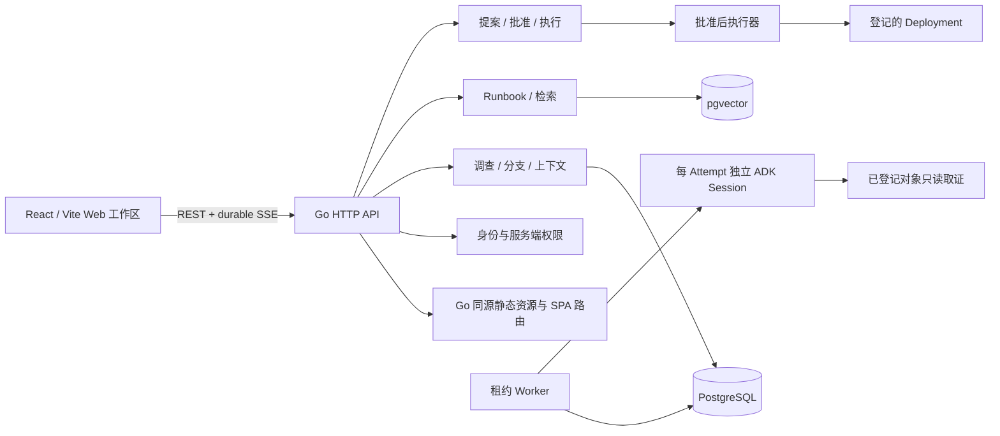

# AIOps Canvas 实施架构

状态：2026-09-20 Web 工作区与 Go 服务已连接，完成本轮限定构建、契约和浏览器检查。当前完整版本尚未经过真实模型与 Kubernetes 恢复验收；证据边界见 CHECKPOINT.md 和 [Web 交接](web-workspace.md)。本轮用户授权前后端并行，取代此前前端暂停决定，仍不开展大面积测试。

## 状态和职责

- 身份：单工作区三种角色。管理员管理账号与集成，操作员调查并批准执行，只读用户仅查看。Cookie 认证、同源写请求；所有授权在服务端执行。
- 调查：PG 保存完整已提交历史、不可变上下文版本、分支、证据、任务与尝试。位置/折叠/草稿按用户存储，不改变业务语义。
- 运行：分支单活，独立分支可并行。任务持有冻结输入；重启创建新 Attempt。持久租约 fencing 防止旧尝试提交。SSE 发布已提交事件并支持序号续读。
- 推理：ADK 处理有限轮数模型/工具交互。每 Attempt 使用新的 SessionService；工具结果先入库再返回模型。模型不能调用写执行器。
- 知识：原文及版本为权威，向量是可重建索引。Embedding 和向量适配器独立；代次绑定提供者/模型/维度，不能混检。首版只支持 PG + pgvector。
- 动作：计划不可变，批准绑定摘要与目标，执行前复核身份和模板。外部未知结果先协调实际状态；不声称跨 PG/Kubernetes 恰好一次。

## 前后端契约

API 统一前缀 `/api/v1`，JSON snake_case；OpenAPI 与示例随代码版本维护。节点对话和侧边栏对话读取同一 Branch；换模型只影响下一轮。前端只将持久事件当正式历史，断线按序号补读并去重。卡片隐藏不发取消请求。

业务内容多人共享；布局、草稿按当前用户隔离。暂不加入实时协同拖拽。前端模块通过公共 API 与类型接入，不读取 PG、ADK 对象或进程内状态。

## Web 模块与状态

`web/src/features` 按应用概览、调查、知识、设置、动作分组；路由懒加载。共享 API 请求、错误处理、工作区选择与基础组件位于 `lib`、`components`。React Flow 管理可拖动节点与连线，assistant-ui 外部状态接口展示分支对话，TanStack Query 缓存后端资源，Zustand 传递待发送草稿和 Runbook 引用。节点与侧栏读取同一分支/草稿；布局请求按用户保存并串行提交，卡片状态与推理生命周期分离。

开发时 Vite 代理 API/SSE 到 Go；部署时 Go 从 `AIOPS_WEB_DIR` 提供构建资源。API、缺失资源与 SPA fallback 分开处理，静态文件边界由 `os.Root` 约束。配置清单仅返回脱敏状态；模型、集群、遥测地址和凭据仍由服务端管理。

`?preview=1` 是明确标记的视觉预览入口，数据来自独立 fixtures，不向后端提交模型、审批或执行请求。正式会话通过 Cookie 认证，401 失效时回到登录；前端隐藏按钮不替代后端权限检查。

## 首发部署

模块化单体 API 与 Worker 同进程，Compose 运行应用与 PG + pgvector。本机仅回环端口；服务器部署由 HTTPS 反向代理提供 TLS。模型地址与凭据由服务端配置，禁止发送给浏览器。应用数据、模型服务、Kubernetes 的运行位置分别配置。

## 扩展边界

稳定替换点是模型、Embedding、向量索引、业务仓储、取证和动作连接器。SQLite/Qdrant/Milvus/ContextDB、分布式 Worker、桌面安装及插件市场均不代表首发已支持。

### 源码中的接口位置

| 职责 | 接口与实现 |
| --- | --- |
| 身份、调查、租约与事件 | `internal/store/repository.go` 分为 IdentityRepository / InvestigationRepository / RunRepository；HTTP 与 Worker 依赖接口，PG 实现在 store 内 |
| 推理与模型 | `internal/inference/runtime.go` 的 Runner；ADK Runtime 适配 Ollama / OpenAI-compatible / Claude |
| Embedding | `internal/inference/embedding.go` 的 Embedder；提供者和模型标识随索引代次保存 |
| 知识源与向量索引 | `internal/knowledge/knowledge.go` 的 Repository / VectorIndex；`drafts.go` 的 DraftRepository；PG 适配器负责事务与代次切换 |
| 人工决策与动作 | `internal/actions/actions.go` 的 Repository / Connector；PG 审批记录与 Kubernetes 条件更新分别封装 |
| 遥测 | `internal/connectors/telemetry.go` 封装固定 PromQL、Loki 标签范围、时间窗和凭据；`cmd/aiops/telemetry.go` 完成工具与 HTTP 装配 |

当前扩展方式为编译期接口和服务端配置，不包含进程内动态装载不受信任插件。配置密钥文件不经公共 API 返回。业务仓储与向量索引分开，因此未来 PG + Qdrant 或 SQLite + Qdrant 可以各自适配；仍需实际实现与一致性验收。

### 上下文与结案边界

合并预览冻结源与目标版本，确认时复核。可按消息选择或仅引用证据；来源记录保存在新版本中。父版本水位只在完整的直接父消息同步后推进。冲突信息供人工审查，不宣称自动理解并解决语义冲突。

提案决策为 pending / approved / rejected / revoked。审批后尚未入队时可撤销；入队后不能用撤销伪装成取消已发生的外部写入。执行单独记录 queued / executing / verifying / succeeded / failed / needs_attention。

结案与新推理、新执行入队在调查行锁下协调。结案要求同调查最新动作成功，且无活跃 Run 或 Execution；报告保存提案、批准、恢复结果及证据快照。关闭后的调查拒绝新增上下文和动作，已有幂等请求仍返回原资源。经验先保存为不参与检索的草稿，经操作员在结案后确认，产生唯一知识源；索引失败保留原文供重建。

以上为最新源码设计。当前仅进行了改动范围内验证，没有完成并发故障、全模型协议或真实恢复矩阵。历史后端边界见 [后端交接](backend-handoff.md)，本轮界面与接口交接见 [Web 工作区](web-workspace.md)。
