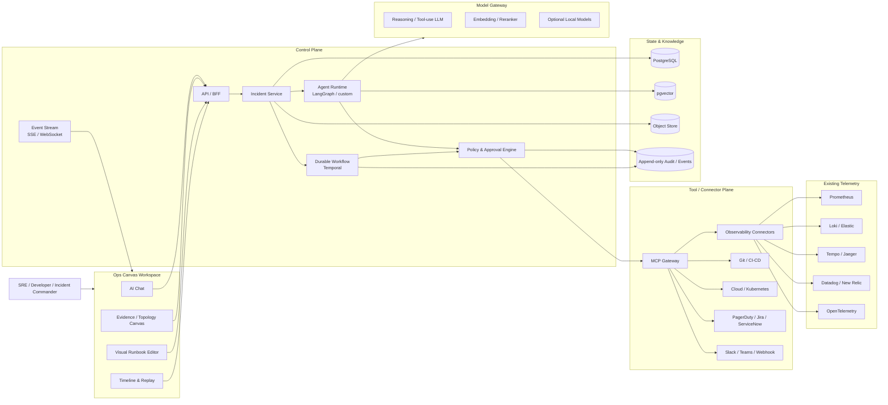
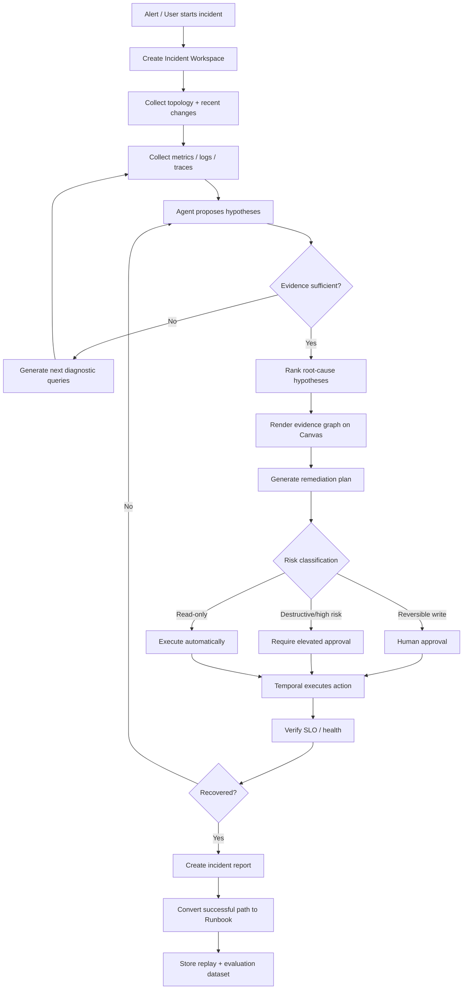

# AIOps × Canvas Chat × Visual Workflow：面向 AI SRE / AI DevOps 的开源项目可行性研究

> **研究基准日：2026 年 9 月 18 日。** 本报告重点参考项目官方仓库、官方文档、CNCF、OSI、OWASP 及云厂商官方资料；GitHub 社区数据为研究时点快照，会持续变化。

## 执行摘要

### 可行性结论

**结论：值得做，而且现在仍有明显的产品空位；但不建议再做一个“聊天机器人 + Prometheus 查询器”，也不建议做另一个通用 Dify/Langflow。真正有机会形成精品开源项目的方向，是把产品定义为：**

> **一个面向 SRE/DevOps 的“可执行 Incident Canvas”：AI 与人共同在画布上构建证据、假设、服务拓扑、时间线和 Runbook；聊天是自然语言控制面，Visual Workflow 是可审计、可复用、可批准、可回放的执行面。**

截至 2026 年，AI SRE 已明显从“问答辅助”进入 **Agentic Operations** 阶段。HolmesGPT 已经能够后台持续发现问题、跨 Prometheus/Grafana/Datadog/Kubernetes/云平台等数据源调查，并进一步通过 GitHub 创建修复 PR；Azure SRE Agent 已提供 Skill、Python Tool、自定义 Agent 和 MCP 扩展，并可以在授权范围内查询乃至操作 Azure 资源；Datadog Bits AI SRE 的产品界面已经出现“对话 + hypothesis tree（假设树）”式调查体验。citeturn21view1turn20search21turn20search14

与此同时，AI DevOps 也已经越过单纯代码补全：GitHub Copilot 可以从 issue 接管任务、实施修改并形成 PR；GitLab Duo Agent Platform 已出现可视化/Agent 化的 Flow Creator。这意味着“自然语言 → Agent → 工具 → 可审查产物”正在成为 DevOps 的主流交互范式，而不仅是 IDE 里的代码补全。citeturn23search3turn22search1

但开源市场目前仍然是**三块拼图相互分离**：

| 能力层 | 当前精品/代表 | 已经做得较好 | 仍然缺失 |
|---|---|---|---|
| AI SRE / RCA | HolmesGPT、OpenDerisk、K8sGPT、SREWorks | 多源诊断、RCA、Agent、K8s、部分自动化 | 产品级协作 Canvas、可视化可执行调查过程 |
| AI Canvas / Workflow | Dify、Langflow、LangGraph | Agent Workflow、RAG、模型/工具编排 | SRE 语义、事件证据模型、风险控制、Incident lifecycle |
| Chat / Generative UI | assistant-ui、CopilotKit | Chat、Generative UI、共享状态、HITL | 运维领域的证据图和执行模型 |
| Durable Workflow | Temporal、Argo、Airflow | 重试、状态、DAG、长期执行 | AI 原生的人机调查 UX |
| 商业 AI SRE | Datadog Bits、Azure SRE Agent、Rootly、PagerDuty | 深度集成、生产级运维、Agentic RCA | 开放、厂商中立、自托管的统一 Canvas |

因此，**你的设想不是一个“没人做过”的方向，但目前也没有出现一个已经垄断“AI SRE + Canvas + Chat + Visual Workflow”交叉点的开源精品。** 最接近的开源作品是 OpenDerisk 和 HolmesGPT：前者已经强调多 Agent RCA 和可视证据链，后者在真实运维数据源、Operator 模式和集成广度上更成熟；而 Dify/Langflow 是最接近的通用视觉 AI Workflow 产品，但它们不是 SRE 产品。citeturn1search0turn0academia25turn21view1turn21view2turn21view3

这是本项目最大的机会。

### 核心判断

我会给这一项目的综合可行性打 **8/10**：

| 维度 | 判断 | 说明 |
|---|---:|---|
| 技术可行性 | **9/10** | UI、Agent、Workflow、Observability、MCP 等基础设施均已成熟到可组合 |
| 开源差异化 | **8/10** | 精品 AI SRE 已有，但“Incident Canvas + executable workflow”仍明显不足 |
| 商业潜力 | **8/10** | AI SRE 正被 Datadog、Azure、Rootly、PagerDuty 等明确产品化 |
| MVP 难度 | **7/10** | 4–6 人团队可做；最大工作量不是 LLM，而是数据连接器和状态模型 |
| 安全难度 | **高** | 运维 Agent 有生产写权限后风险远高于普通 AI Chat |
| 社区冷启动 | **中高** | 需要用真实 Demo、故障数据集、连接器生态形成飞轮 |
| 被大厂复制风险 | **高** | 因此必须建立开放协议、插件生态、跨厂商/自托管优势 |

最大的战略错误会是把产品定义成“AI 自动根因分析平台”。这个赛道已经非常拥挤。HolmesGPT、OpenDerisk、Datadog Bits AI SRE、Azure SRE Agent 都在推进该方向。citeturn21view1turn1search0turn20search14turn20search21

更好的定位是：

> **“GitHub + Figma + Temporal for production incidents”——Incident 的共享工作区、推理画布和自动化执行系统。**

也就是说，不以“模型有多聪明”为护城河，而以 **结构化运维上下文、证据可追溯、Human-in-the-loop、Workflow 可执行/可回放、开放连接器生态** 为护城河。

---

## 市场与开源生态：AI SRE、AI DevOps 和现有精品

### AI SRE 正在从 Copilot 走向 Operator

传统 AIOps 的主轴是异常检测、告警聚合、事件关联、容量预测与统计 RCA；新一代 AI SRE 则把 LLM/Agent 放到这些数据之上，执行“观察 → 查询 → 建立假设 → 找证据 → 给出修复 → 执行/生成 PR → 验证”的循环。

HolmesGPT 是这个变化非常典型的代表。它目前将自己定义为 CNCF SRE Agent，可以从 Prometheus、Grafana、Datadog、Kubernetes、AWS/Azure/GCP、Elasticsearch/OpenSearch、ServiceNow、PagerDuty、GitHub/GitLab/Jenkins 等来源取得信息；Operator Mode 能后台运行健康检查，并能通过 GitHub 集成创建修复 PR。项目还专门实现了 server-side filtering、输出预算和大数据流式处理，以避免把大规模 observability payload 直接塞进模型 context。citeturn21view1

K8sGPT 则采取更窄但清晰的路线：把 Kubernetes SRE 经验编码成 analyzers，再由 AI 把诊断结果解释为自然语言；它已经支持自定义 analyzers、Operator、Prometheus/Alertmanager 集成、多种模型后端以及 MCP Server。citeturn16view0turn15search7

国内开源里，阿里 SREWorks 是较早的完整 DataOps/AIOps 运维平台，定位为应用中心的一站式云原生 DataOps/AIOps 运维 SaaS；其主仓库约 2k stars、431 forks。它更像传统“运维平台 + AIOps 工程体系”，而不是新一代 Agent-native 产品。citeturn15search6turn15search0turn15search10

OpenDerisk 则代表更接近你设想的新路线：项目以 AI-native risk intelligence 为定位，在 AI-SRE 场景中做日志、trace、代码之间的 DeepResearch RCA，采用多 Agent，并强调可视证据链；项目还提供 OpenRCA 数据集。其论文报告了在蚂蚁集团生产环境中的部署以及数千日用户，不过这些生产效果数字来自项目作者本身，应视为项目方报告，而不是独立第三方验证。citeturn1search0turn0academia25

#### 开源 AIOps / AI SRE 项目比较

| 项目 | 核心用途 | 主要语言 | License | 成熟度 | 社区规模快照 | 扩展性 / 与本项目关系 |
|---|---|---|---|---|---|---|
| **HolmesGPT** | AI SRE、跨源生产事故 RCA、Operator | Python | Apache-2.0 | CNCF Sandbox，快速进入生产场景 | ≈3.4k stars / 493 forks | **很强**；大量 toolsets、MCP、REST、云/可观测性集成，可考虑直接复用 Agent/tool 层 citeturn21view1 |
| **OpenDerisk** | 多 Agent SRE RCA、风险分析、Evidence Chain | Python 为主 | MIT | 新兴但产品形态先进 | ≈974 stars / 129 forks | **非常相关**；目前开源领域与“可视证据 + RCA”概念最接近 citeturn1search0turn0academia25 |
| **K8sGPT** | Kubernetes 扫描、诊断、自然语言解释 | Go | Apache-2.0 | 成熟的垂直工具 | core repo 约 1.1k forks，持续活跃 | analyzers、MCP、Operator 很适合作为 K8s connector / diagnostic provider citeturn16view0 |
| **SREWorks** | 企业云原生 DataOps/AIOps 平台 | Java/Go/前端多语言 | Apache-2.0 | 较成熟、传统平台型 | ≈2k stars / 431 forks | AIOps 工程参考价值高；整体架构较重，不建议直接作为新项目底座 citeturn15search0turn15search6 |

**精品判断：** 如果只看“AI SRE Agent”，HolmesGPT 已经称得上精品；如果看“LLM 驱动 RCA + 可视证据”，OpenDerisk 是目前尤其值得认真拆解的项目。但两者仍没有把 **多人可编辑 Canvas、Chat 与 executable visual workflow** 做成产品核心，因此并没有直接封死你的空间。citeturn21view1turn1search0

### AI DevOps 正在向“软件交付 Agent”扩张

AI DevOps 的边界现在大致可以分成四层：

**Coding Agent** 已从 autocomplete 变成 issue-to-PR。GitHub Copilot 官方已经明确支持让 Agent 接手 issue、实施代码变化并产生 PR；GitLab 在 2026 年发布的 Duo Agent Platform 进一步加入 Flow Creator，用于创建自定义 Agent flows。citeturn23search3turn22search1

**CI/CD Agent** 开始分析失败 Pipeline、测试、部署、release 与基础设施状态；HolmesGPT 自身已经提供 CI/CD troubleshooting，并能够连接 GitHub、GitLab、Jenkins、ArgoCD。citeturn21view1

**SRE Agent** 从“回答问题”转向始终在线的后台 operator。HolmesGPT Operator Mode 明确体现这一趋势；微软则直接把 Azure SRE Agent 描述为自动化重复运维工作、进行自主 incident mitigation 和资源优化的 Agent。citeturn21view1turn20search4

**Autonomous DevOps / ZeroOps** 则是最终愿景：Agent 长期运行，人类主要负责策略、审批和异常处理，而不是逐个执行 shell/API 操作。微软 2026 年关于 Azure SRE Agent 的官方材料已经直接用 “agentic operations” 描述这一方向。citeturn20search5turn20search21

值得注意的是，市场并没有简单追求“完全自动”。Grafana Labs 2026 Observability Survey 显示，受访者普遍认可 AI 在预测、RCA、查询和告警等场景的价值；自主行动也受到多数人认可，但同时是更容易产生质疑的领域。这说明真正的产品机会不是“取消人类”，而是**让人能够理解 Agent 为什么这么做、看到证据、审批高风险操作并能够回放**。citeturn13search8

这恰好非常适合 Canvas。

### 商业产品已经走到哪里

| 产品 | 当前方向 | 自动化深度 | 对你的启示 |
|---|---|---|---|
| **Datadog Bits AI SRE** | 多数据源调查、深度推理、chat、hypothesis tree | RCA/调查很深，并持续向自主操作扩张 | UI 已经验证“Chat + 可视 hypothesis tree”是有价值的方向，但仍是 Datadog-centric citeturn20search14turn20search18 |
| **Azure SRE Agent** | 云资源调查、Skills、Runbook、Python Tool、Custom Agent、MCP | 可在授权范围查询和操作资源 | 非常接近“Agentic Operations OS”；但天然 Azure-centric，且是商业云产品 citeturn20search21turn20search5 |
| **Rootly AI SRE** | 联合代码变化、Telemetry、历史 incident 做 RCA/修复建议 | 事故响应全过程 AI 化 | 说明 incident management + AI SRE 是独立商业赛道，而非 observability 附属功能 citeturn14search2turn14search17 |
| **PagerDuty AIOps / Advance / AI Agents** | 告警聚合、noise reduction、incident automation、AI | 从事件管理逐步向 Agent 发展 | 工作流和执行侧很强，但 Canvas/推理可视化不是核心 citeturn19search39turn19search27 |
| **腾讯云 DataBuddy** | Chat、Agent、可视 DAG、CI/CD、OPS、AI RCA | 在大数据工程范围已经形成开发→Workflow→OPS→诊断闭环 | **非常值得关注**：它证明“Chat + Workflow + Ops + RCA”这个产品组合在商业侧已经成立，只是主要服务数据工程场景 citeturn23search5turn23search2 |
| **阿里云 SLS / OOS 体系** | 告警、日志分析、AI Skill、运维编排 | 告警诊断 + 自动化运维 | 说明中国市场同样正在从 observability 向 AI Skill / Agent 过渡 citeturn23search0 |
| **华为云 AIOps** | AI 异常检测、业务指标监控、故障定位 | 偏传统 AIOps + 云运维 | 异常检测本身已经高度商品化，不应作为新项目主要差异点 citeturn23search1 |

**商业侧已经证明需求，开源侧尚未完成产品统一。** 这是比较健康的创业/开源窗口：不是教育市场，而是用开放性和 UX 去重构已经存在的预算类别。

### Canvas、Chat 与 Workflow 基础设施

真正没必要重造的是通用 Agent Builder。

Dify 已经将 Workflow、RAG、Agent、模型管理、工具和 LLMOps 集于一体，社区规模约 15 万 stars；但其许可证是“基于 Apache 2.0、带附加条件”的 Dify Open Source License，因此如果你的项目坚持严格 OSI-style OSS，应特别谨慎对待把它作为核心可再分发依赖。citeturn21view3turn8view1

Langflow 同样已经是大型 Visual Agent Workflow 平台，约 15 万 stars，并支持自定义 Python components、API、MCP 和多 Agent workflow。它更适合作为产品设计参考或者可选 integration，而不是把你的 SRE 产品做成一个 Langflow skin。citeturn21view2

一个非常重要的生态风险信号是 **Flowise 在 2026 年 8 月 13 日被仓库所有者归档为 read-only**。这说明即使是大型热门 AI workflow OSS，把项目核心强绑定到某个快速变化的 Agent Builder 也存在相当大的供应链风险。citeturn7view1

因此对于你的产品，我反而建议用更底层的 UI primitives。

| 项目 | 用途 | 技术/语言 | License | 社区规模 | 推荐程度 |
|---|---|---|---|---:|---|
| **React Flow / xyflow** | Node-based Canvas / Workflow Editor | TypeScript/React | MIT | ≈38.4k stars | **强烈推荐：Canvas 核心** citeturn5search2turn5search19 |
| **assistant-ui** | Production AI Chat / Generative UI / HITL | TypeScript/React | MIT | ≈12.2k stars | **强烈推荐：Chat 层**；支持 LangGraph、AG-UI/A2A、自定义 runtime citeturn18view0 |
| **CopilotKit** | Agent-native UI、共享状态、Generative UI、HITL | TypeScript | MIT | ≈37.4k stars | 很适合后期做 Agent ↔ Canvas shared-state；AG-UI 值得关注 citeturn17view3 |
| **Gradio** | 快速 ML/AI Demo、Chat UI | Python | Apache-2.0 | ≈43.6k stars | PoC 极佳，产品级 Canvas 不理想 citeturn9view1 |
| **Streamlit** | Python 数据应用、dashboard、chat prototype | Python | Apache-2.0 | ≈45.8k stars | 快速验证很好；不建议作为最终复杂协作前端 citeturn18view2 |
| **LangGraph** | Stateful / long-running Agent graph | Python/TS | MIT | ≈41.8k stars | 推荐用于 **AI reasoning graph**，不建议独自承担生产运维业务工作流 citeturn17view1 |
| **Dify** | 通用 AI App / visual workflow | Python/TS | 定制 Dify License | ≈156k stars | 功能参考价值极高，但核心依赖需考虑许可证与产品重叠 citeturn21view3turn8view1 |
| **Langflow** | Visual Agent/AI Workflow | Python/TS | MIT | ≈155k stars | 很好的组件/UX参考，作为 SRE 产品底座则耦合较重 citeturn21view2 |

### Workflow Engine 怎么选

这里必须区分两个“Workflow”：

> **LLM reasoning workflow ≠ production automation workflow。**

LangGraph 很适合表达“Agent 下一步思考什么”；但 incident remediation 需要数小时甚至数天保持状态、等待审批、重试 API、处理 worker crash、记录审计信息，此时更适合 durable workflow engine。LangGraph 本身也支持 durable execution 和 Human-in-the-loop，但其抽象仍主要面向 Agent state machine。citeturn17view1

| Engine | 核心模型 | 主要语言 | License | 社区规模 | 对 AI SRE 的适合度 |
|---|---|---|---|---:|---|
| **Temporal** | Durable execution、长期 stateful workflow | Go server + 多语言 SDK | MIT | ≈23.2k stars | **最佳默认选择**：incident、审批、retry、timeout、长事务非常匹配 citeturn11view3turn12view2 |
| **Argo Workflows** | Kubernetes-native container DAG | Go | Apache-2.0 | ≈17k stars | Kubernetes job / remediation pipeline 很强；CNCF Graduated citeturn11view1turn12view1 |
| **Airflow** | Scheduled DAG / data workflow | Python | Apache-2.0 | ≈46.9k stars | 数据/周期任务成熟；官方也强调更适合有限、批处理式 workflow，而非持续事件交互 citeturn10view0turn12view0 |
| **Prefect** | Dynamic Python data workflow | Python | Apache-2.0 | ≈23.9k stars | Python-native、上手快，适合数据/AI Pipeline，incident durability 仍不如 Temporal 对口 citeturn11view5turn12view3 |

**我的选择是 Temporal。** Argo 作为 Kubernetes execution backend 可以后续增加，但不应让 Kubernetes 成为整个产品的前提。

---

## 技术拆解与推荐架构

### 关键设计：不要再造 Observability Backend

项目最容易犯的架构错误是第一天就开始写：

- 自己的 metrics TSDB；
- 自己的 log backend；
- 自己的 trace store；
- 自己的 anomaly detector；
- 自己的 CMDB。

这会迅速变成一个弱版 Grafana/Elastic/Datadog。

更好的方式是建立 **Federated Ops Intelligence Layer**：

> 数据留在 Prometheus/Loki/Tempo/Elastic/Datadog/New Relic/云平台中；系统通过 Connector/Tool Gateway 动态查询，只保存“调查需要的证据、引用、摘要、快照和 provenance”。

HolmesGPT 已经采用 server-side filtering 和工具输出转换来避免直接把 PB 级 observability 数据送进 context，这很好地证明了这一架构原则。citeturn21view1

### 推荐总体架构



这个架构有一个非常重要的分层：

**LangGraph/Agent runtime 决定“下一步该调查什么”；Temporal 决定“这个工作是否可靠执行完”。**

Agent 可以被升级、替换乃至崩溃；真正具有业务含义的 incident execution state 不应该锁死在某个 Agent framework 中。LangGraph 官方明确把自身定位为长运行、stateful agent 的低层 orchestration framework，并提供 durable execution 和 HITL；而这正说明它适合 Agent 内部推理，但产品仍应该拥有自己的 canonical incident/workflow domain model。citeturn17view1

### Canvas 应该是什么，而不是什么

不要做成一个“可以拖节点的 Workflow 页面”。

Canvas 应该有至少五种一等公民节点：

| Node 类型 | 示例 | 为什么重要 |
|---|---|---|
| **Evidence** | log slice、metric anomaly、trace span、deployment diff | 所有 AI 结论必须能回到证据 |
| **Entity** | service、pod、DB、API、host、team | 构造 service dependency / blast radius |
| **Hypothesis** | “DB connection pool exhaustion” | 允许 AI 和人显式管理假设 |
| **Action** | query、rollback、scale、restart、open PR | 把推理连接到执行 |
| **Artifact** | incident report、PR、runbook、postmortem | 将调查结果沉淀为知识 |

每一个 Evidence Node 都应该保存：

`source + query + time_range + fetched_at + raw_ref + normalized_excerpt + trust_label + hash`

这样 Canvas 才不只是视觉效果，而是 **Evidence Graph**。

这也是你与普通 Dify/Langflow 的根本不同点。

### Chat 与 Canvas 的交互模式

理想体验不是左边 Chat、右边白板，两者互不相干，而是双向共享状态。

**Chat → Canvas**

用户问：

> “为什么 checkout-api 从 10:32 开始 p99 升高？”

Agent 查询 metrics、trace、deployments 后，不只是输出一页文字，而是自动生成：

`Latency anomaly → checkout-api → DB spans → connection pool saturation → deployment #1837`

并把这些内容加入 Canvas。

**Canvas → Chat**

用户框选 `deployment #1837 + DB saturation` 两个节点，然后问：

> “只根据这些证据验证这个假设。”

此时 Canvas Selection 就是 Agent 的 scoped context，而不是再次让用户描述上下文。

**Chat → Workflow**

用户说：

> “把这次处理过程转成一个 runbook，下次先检查连接池，再检查最近部署；如果确认是配置变化，就生成 revert PR。”

Agent 生成 Visual Workflow 草稿，而不是直接执行。

**Workflow → Canvas**

执行过程中，每一步产生 Evidence/Action/Result 节点，并实时反映：

`pending → running → awaiting approval → succeeded / failed`

assistant-ui 已经提供 Generative UI、工具调用渲染以及 inline human approvals；CopilotKit 则进一步提供 shared state 和 human-in-the-loop，这两者都说明“Agent 与应用状态双向联动”已经有成熟开源 primitives 可用。citeturn18view0turn17view3

### 一个典型 Incident Workflow



这里最有价值的不是最后那句 AI 总结，而是：

> **故障调查本身变成了一份结构化、可执行、可学习的数据。**

这可以产生强飞轮：每解决一次 incident，就多一个 future runbook、RCA example 和 agent evaluation case。

### 核心后端组件

#### 数据接入与标准模型

第一阶段优先接：

`Prometheus + Loki/Elastic + Kubernetes + GitHub + Alertmanager/PagerDuty`

而不是追求“一百个 connector”。

建议内部统一成几个 Domain Object：

```text
Incident
Entity
Signal
Evidence
Hypothesis
Action
Workflow
WorkflowRun
Approval
Artifact
Relation
```

这层 canonical schema 非常重要，它应该独立于 Prometheus、Datadog、Kubernetes 和任何 LLM provider。

HolmesGPT 已经证明连接器生态是 AI SRE 的关键竞争力：官方仓库列出的集成涵盖 Kubernetes、Prometheus、Grafana、Datadog、AWS/Azure/GCP、GitHub/GitLab/Jenkins、Elastic/OpenSearch、Kafka、SQL、ServiceNow、PagerDuty 等。citeturn21view1

#### Observability 与异常检测

MVP 不需要训练深度异常检测模型。

优先顺序应该是：

**已有告警 / SLO → Prometheus rule → 简单 statistical detector → 复杂 ML anomaly detection。**

原因是 AI SRE 的差异化主要不在“又发现一个 CPU anomaly”，而在于跨 metrics、logs、traces、deployments 和知识库进行关联与解释。

传统 AIOps 异常检测已非常成熟，华为云当前官方方案也已经将 AI 动静态算法用于业务指标异常检测和故障定位，因此把“异常检测算法”作为核心护城河已经不合适。citeturn23search1

#### RCA

推荐三层 RCA：

**确定性层**：拓扑、时间关系、deployment diff、指标变化、error rate。

**检索层**：runbook、postmortem、代码、历史 incident、Git change。

**Agent reasoning 层**：提出假设、规划下一次查询、综合证据。

不要让 LLM 直接看到几十万行日志后“猜 RCA”。

更可靠的协议是：

```text
Hypothesis
├── claim
├── supporting_evidence[]
├── contradicting_evidence[]
├── confidence
├── missing_evidence[]
└── next_tests[]
```

这使得 UI 自然可以画出 Evidence/Hypothesis graph，并且允许用户否决单个假设而不是推翻整个 Chat session。

### ML / NLP 模型需求

MVP **完全不需要自己训练 foundation model**。

需要的是四类模型能力：

| 能力 | MVP | 后期 |
|---|---|---|
| Tool-use / reasoning LLM | 必需 | 多模型路由、小模型/大模型分层 |
| Embedding | 建议 | 领域 embedding |
| Reranker | 可选 | 历史 incident / runbook 精排 |
| Time-series ML | 使用现有工具即可 | 专门 anomaly forecasting |

应该做 Model Gateway，而不是将产品硬编码到一个 API。HolmesGPT 已经支持 OpenAI、Anthropic、Azure、Bedrock、Gemini 等多个 provider；K8sGPT 同样支持多模型和本地后端，这已经成为 AI SRE 开源项目的基本预期。citeturn21view1turn16view0

### 状态管理

推荐把状态分成三个层次：

**Authoritative state：PostgreSQL。**

Incident、Canvas nodes、Workflow Definition、Approval、Artifact 等产品状态必须是普通数据库实体。

**Execution state：Temporal。**

任务状态、重试、timeout、等待审批、signal 和长期 workflow state 由 Temporal 管理。Temporal 的核心价值正是 durable execution：即使 worker 或网络发生间歇性失败，Workflow 仍能恢复执行。citeturn11view3turn12view2

**UI transient state：React。**

Canvas zoom、selection、drag 等状态可以 local-first；多人实时协作成熟后再加入 Yjs/CRDT。第一版不要为了“像 Figma”先把 CRDT 做半年。

### 安全模型是项目成败点

AI SRE 最大的问题不是 hallucination，而是：

> **带工具权限的 hallucination。**

OWASP 的 Agent Security 指南明确将 direct/indirect prompt injection 列为重要风险：来自网站、文档、邮件等外部来源的数据可能包含恶意指令，并劫持 Agent 行为。日志、ticket、Git issue、runbook、CI output 本质上全部应该被视为“不可信 Agent 输入”。citeturn22search2turn22search4

因此必须从第一版就建立四级工具权限：

| 风险等级 | 示例 | 默认策略 |
|---|---|---|
| L0 Read | 查 metrics/logs/trace | Agent 可自动执行 |
| L1 Local | 生成 query / report | 自动执行 |
| L2 Reversible Write | scale、restart、PR | 明确审批或策略授权 |
| L3 Destructive | delete、DB change、production mutation | 高权限审批，默认关闭 |

HolmesGPT 默认 read-only 并遵守现有 RBAC，这是很好的开源默认行为。citeturn21view1

另外必须实行：

- Tool Gateway 与 Agent Runtime 隔离；
- 每次 tool call 使用用户或 service identity，而非万能 root token；
- secrets 不进入 LLM prompt；
- command / Python sandbox；
- 网络 egress allowlist；
- model/tool 输出 schema validation；
- immutable audit trail；
- Canvas 中显式标注 AI-generated / human-confirmed / system-observed；
- 所有 remediation 提供 dry-run；
- 高风险 workflow version 必须签名或审批。

腾讯云 DataBuddy 2026 文档已经公开描述了类似思想：Agent Guardrails、真实用户身份权限绑定、高危操作识别，以及当“不可信输入 + 状态改变 + 敏感数据”同时出现时触发人工确认。这说明这些机制正在从安全理论进入实际商业 AI 运维产品。citeturn23search5

---

## MVP 原型方案与实施路径

### 建议产品定义

可以暂时称之为 **OpsCanvas**。

一句话：

> **Open-source collaborative workspace for AI-assisted incident investigation and executable SRE runbooks.**

首页不要展示“Create Agent”。

首页应该是：

```text
Incidents
 ├─ checkout latency regression
 ├─ payment DB saturation
 └─ api deployment failure

Runbooks
Integrations
Evaluations
```

打开 Incident 后才进入：

```text
┌───────────┬─────────────────────────────────────┬───────────────┐
│ Timeline  │                                     │ AI SRE Chat   │
│           │         Evidence Canvas             │               │
│ Alert     │                                     │ Ask           │
│ Deploy    │    API ─── DB ─── Deployment       │ Investigate   │
│ Errors    │      \       \                      │ Explain       │
│ Fix       │     trace    hypothesis             │ Run action    │
│           │                                     │               │
├───────────┴─────────────────────────────────────┴───────────────┤
│                     Executable Workflow                         │
└─────────────────────────────────────────────────────────────────┘
```

这与 Dify 的“建 Agent”入口有本质区别。

### 第一版功能边界

MVP 只做一条闭环：

> **收到 Kubernetes/Prometheus incident → AI 调查 → Evidence Canvas → 用户追问/修正 → 生成 remediation plan → 审批 → 执行或创建 PR → 验证 → 自动 incident report。**

第一版连接器控制在：

`Kubernetes / Prometheus / Loki / GitHub / Alertmanager + generic REST/MCP`

这已经足够演示完整价值。

### 推荐技术栈

| 层 | 推荐 | 理由 |
|---|---|---|
| Web | **Next.js + TypeScript** | 产品级 UX、生态成熟 |
| Canvas | **React Flow / xyflow** | 与节点/边/Workflow 场景高度匹配，MIT，社区成熟 citeturn5search2turn5search19 |
| Chat | **assistant-ui** | MIT、Chat primitives、Generative UI、approval、LangGraph/AG-UI adapter citeturn18view0 |
| Agent UI protocol | **AG-UI 可选** | CopilotKit 生态已验证 shared-state / human-in-loop；避免首版过度抽象 citeturn17view3 |
| Backend | **Python + FastAPI** | AI/observability SDK 生态最好 |
| Agent reasoning | **LangGraph，封装在接口后** | Stateful agent、HITL 和 graph reasoning 成熟 citeturn17view1 |
| Durable workflow | **Temporal** | incident/runbook 是典型 long-running durable process citeturn12view2 |
| Database | **PostgreSQL** | 统一事务数据 |
| Semantic retrieval | **pgvector 起步** | 避免首版增加独立 vector DB |
| Object store | **S3 / MinIO** | 原始 evidence/artifact |
| Observability | **OpenTelemetry + Prometheus-compatible** | 避免自建 proprietary telemetry |
| Tool protocol | **MCP + native adapters** | Azure SRE Agent、HolmesGPT、K8sGPT 等均已采用 MCP，生态趋势很清晰 citeturn20search21turn21view1turn16view0 |
| Deployment | **Docker Compose first，Helm second** | 降低 OSS 初次体验门槛 |
| Auth | OIDC | 企业环境基本要求 |
| Policy | 内置 simple RBAC → 后期 OPA | MVP 避免过度复杂 |

其中最重要的三个“不选”：

**不以 Dify 作为核心 runtime。** 一是产品重叠，二是许可证不是简单 Apache-2.0。citeturn8view1turn21view3

**不以 Airflow 作为 incident runtime。** Airflow 非常成熟，但它天然偏向有限、批处理式 DAG，而 incident interaction 是事件驱动、长时间等待人类输入。citeturn10view0turn12view0

**不自建 telemetry storage。** 让已有 observability 系统承担规模化存储。

### 工程量估算

以下是工程规划估算，而不是行业统计。假定核心团队约 **4–6 名工程师**，包括 1–2 前端、2 后端/平台、1 AI/Agent、1 SRE/DevOps，可有角色重叠。

| 阶段 | 周期 | 关键产物 | 可验收标准 |
|---|---:|---|---|
| Product RFC / Domain Model | 1–2 周 | Incident/Evidence/Hypothesis/Action schema；架构 RFC | 用一个故障案例完整表达调查过程 |
| Foundation | 2–3 周 | Next.js、FastAPI、Postgres、auth、model gateway | 本地一条命令启动 |
| Connectors | 2–3 周 | K8s、Prometheus、Loki、GitHub、Alertmanager | Agent 可从五个来源取证 |
| Chat + Agent | 2–3 周 | Tool calling、investigation loop、streaming | 从告警自动得到有引用的 RCA |
| Evidence Canvas | 3–4 周 | Nodes/edges、timeline、selection→chat | 用户能直接操作 evidence graph |
| Visual Workflow | 3–4 周 | Runbook graph、Temporal、approval、retry | 能将一次调查转成可运行 Runbook |
| Secure Actions | 2 周 | risk classification、dry-run、audit | 所有 write action 均有 policy/approval |
| Evaluation | 2 周 | 故障 fixtures、replay、RCA benchmark | 每次 PR 自动跑 Agent regression |
| Beta Packaging | 2–3 周 | Helm、Docker Compose、docs、demo | 新用户 <15 分钟跑通示例 |

大量工作可以并行，因此不是简单相加。

**现实估计：**

- **6–8 周：** 能 demo 的 alpha；
- **12–16 周：** 有开源发布质量的 MVP；
- **5–6 个月：** 可以开始被真实 SRE 团队试用的 beta；
- **9–12 个月：** 才有可能成为“精品项目”，前提是 connector、可靠性和社区持续投入。

### 首发 Demo 应该非常具体

不要发布一个：

> “Ask anything about your infrastructure”

而应该准备三个可重放故障：

**Deployment regression**

```text
new deploy
→ HTTP 5xx ↑
→ trace isolates payment-service
→ diff finds config change
→ AI proposes revert
→ human approves
→ GitHub PR
→ verify recovery
```

**Database saturation**

```text
p99 ↑
→ DB spans ↑
→ connection pool saturation
→ find recent configuration change
→ evidence graph
→ remediation
```

**Kubernetes failure**

```text
Alertmanager
→ Pod crash
→ Events/OOM
→ resource request mismatch
→ generate manifest PR
```

开源项目是否会火，很大程度取决于用户能否在五分钟内看到“这不是普通 chatbot”。

---

## 社区、治理和商业化策略

### License 建议：Apache-2.0

对于核心项目，我建议 **Apache-2.0**。

OSI 当前仍将 Apache-2.0、MIT、AGPL-3.0 等列为认可的开源许可证；MIT 和 Apache-2.0 仍然是最主流的开源许可证类别。citeturn22search3turn22search8

Apache-2.0 比 MIT 更适合这个项目的主要原因不是代码自由度，而是大型企业通常会更关注其显式的专利授权条款。

可以考虑三种路线：

| 模式 | 优势 | 缺点 | 建议 |
|---|---|---|---|
| Apache-2.0 全核心 | 社区接受度最高、企业友好 | 云厂商可直接托管 | **首选** |
| AGPL-3.0 | SaaS 竞争保护更强 | 企业 adoption 摩擦明显更大 | 除非商业保护优先，否则不推荐 |
| Source-available / 自定义限制 | 商业保护强 | 不再是纯 OSS，损害“开放基础设施”定位 | 不推荐作为核心 |

Dify 的自定义 license 恰恰说明：一旦项目进入 AI platform 赛道，license 会直接影响生态身份。你若希望形成 CNCF 风格的社区信任，最好保持核心协议和 runtime 真正 OSI-approved。citeturn21view3turn22search3

### 社区结构不要围绕“提交代码”，要围绕 Integrations

最值得构建的生态单位不是 Agent，而是：

```text
Integration Pack
├── tools
├── entity schema
├── evidence renderer
├── runbooks
├── permission profile
├── eval cases
└── docs
```

例如：

```text
integrations/
  kubernetes/
  prometheus/
  grafana/
  elastic/
  datadog/
  github/
  gitlab/
  aws/
  azure/
```

一个 Kubernetes contributor 不应该必须理解整个 AI runtime 才能添加 analyzer。

HolmesGPT 已经证明 connector/toolset 数量是 AI SRE 的明显价值来源，其现有集成范围远超过单一 observability backend。citeturn21view1

### Contribution model

建议从第一天建立：

```text
Contributor
    ↓
Reviewer
    ↓
Subsystem Maintainer
    ↓
Core Maintainer
```

大功能采用 RFC：

```text
rfcs/
  0001-incident-domain-model.md
  0002-evidence-provenance.md
  0003-tool-permission-model.md
  0004-workflow-spec.md
```

**不要让核心公司内部 roadmap 成为事实上的唯一 roadmap。**

真正有社区价值的接口——Connector SDK、Workflow Spec、Evidence Schema、Tool protocol——都应该公开讨论。

### CI/CD 的特殊要求

普通 unit tests 对 AI SRE 不够。

CI 应分成：

```text
Unit Tests
Integration Tests
Connector Contract Tests
Frontend E2E
Security Tests
Agent Evals
Incident Replay Tests
```

Agent Eval 至少评估：

| 指标 | 示例 |
|---|---|
| Evidence precision | 引用证据是否支持结论 |
| RCA Top-k | 根因是否进入前三假设 |
| Unsafe tool call rate | 是否尝试越权操作 |
| Tool efficiency | 调查用了多少无意义 query |
| Time-to-hypothesis | 多快找到正确方向 |
| Cost | token / incident |
| Recovery validation | 修复后是否真的验证 |

**这是潜在的另一个开源护城河。**

如果项目将 anonymized/synthetic incident scenarios 做成公开 benchmark，就可能同时吸引 SRE 社区和 Agent research 社区。

OpenDerisk 已经将 OpenRCA 数据集作为项目的一部分，这表明 AI-SRE 的标准化评测数据本身就是生态资产。citeturn1search0turn0academia25

### 文档战略

建议从第一天提供**中英双语**。

中国团队在这一领域其实有独特优势：SREWorks、OpenDerisk 等已经形成中文 AIOps 开源基础，而腾讯、阿里、华为等云平台也都在快速把 AI/AIOps 集成进运维产品。citeturn15search10turn1search0turn23search0turn23search1turn23search5

文档首页最重要的不是 API Reference，而应该是：

```text
Quickstart
5-minute Incident Demo
How the Evidence Model Works
Build Your First Connector
Build Your First Runbook
Security Model
Architecture
Agent Evaluation
```

### 可持续商业模式

最健康的模式是：

> **Open-source control/data model + Managed OpsCanvas Cloud + enterprise governance。**

OSS 保留：

- Canvas；
- Chat；
- Agent runtime；
- Temporal workflow integration；
- 基础 connectors；
- MCP；
- Runbook；
- self-host；
- eval framework。

商业版可以卖：

- Managed cloud；
- HA / multi-region；
- enterprise SSO；
- enterprise audit/export；
- secrets integration；
- fine-grained policy；
- advanced RBAC；
- compliance；
- managed connectors；
- retention；
- cross-tenant analytics；
- enterprise support。

不要把 Prometheus/Kubernetes/GitHub 这类最基础 connectors 锁在付费版，否则开源版本无法形成真正 adoption flywheel。

---

## 风险、阻碍与竞争壁垒

### 最大风险不是模型，而是“可靠闭环”

| 风险 | 严重度 | 原因 | 缓解 |
|---|---|---|---|
| AI 给错 RCA | 高 | correlation ≠ causality | Evidence-first；明确 supporting/contradicting evidence；confidence 而非单答案 |
| 自动修复生产故障 | 极高 | 一次错误操作即可扩大事故 | read-only default、dry-run、approval、RBAC、rollback |
| Indirect prompt injection | 极高 | logs/tickets/code 都可能带恶意文本 | untrusted-data label、指令/数据隔离、tool policy、sandbox；OWASP 已明确识别此类攻击 citeturn22search2 |
| Context 爆炸 | 高 | Telemetry 远超 LLM context | server-side aggregation/filtering；HolmesGPT 已采用该方案 citeturn21view1 |
| Connector 工作量失控 | 高 | 每家 observability API 都不同 | MCP + Connector SDK + community packs |
| AI framework churn | 中高 | 生态变化极快 | 自有 domain model；LangGraph/Dify 等均在 adapter 后 |
| OSS dependency 被归档 | 中 | AI 开源领域迭代激烈 | 小依赖、标准协议、可替换；Flowise 2026 被归档是现实案例 citeturn7view1 |
| License 风险 | 中 | 某些“开源”产品使用附加限制 | 依赖审计；核心仅使用兼容 OSI license；Dify需特别检查 citeturn21view3turn22search3 |
| 模型成本 | 中 | 长 incident 会有大量工具循环 | Small/large model routing、cache、context compaction |
| 模型供应商变化 | 中 | API/价格/模型持续变化 | model gateway，多 provider，本地模型可选 |
| 社区没有贡献者 | 高 | AIOps 平台代码复杂 | Integration SDK、good-first connectors、incident dataset |
| 与 Holmes/OpenDerisk 正面撞车 | 中高 | 两者发展很快 | 不争“最好 RCA agent”；争“最佳 open incident workspace / Canvas” |

### 最值得警惕的竞争对手

**HolmesGPT 是开源侧最大的潜在重叠者。**

它已经具有：

- 多源调查；
- Operator；
- GitHub remediation PR；
- MCP；
- broad connectors；
- CNCF 身份；
- SRE 社区。citeturn21view1

因此不应该试图复制它。更合理的战略甚至是：

> **把 HolmesGPT 当成可插拔 investigator backend。**

你的系统提供 Canvas、state、workflow、approval、collaboration、evidence provenance；Holmes 可以是其中一个 investigation engine。

这样既降低初期研发量，又避免在社区层面形成“为什么不用 HolmesGPT”的问题。

**OpenDerisk 是产品理念最接近的开源竞争者。**

它已经走到多 Agent + DeepResearch RCA + Visual Evidence Chain，因此需要密切跟踪。citeturn1search0turn0academia25

但你的差异化可以进一步锁定：

> Evidence Canvas **不只是展示 RCA，而是运行整个 incident。**

也就是：

```text
visualization
       ↓
shared reasoning state
       ↓
executable workflow
       ↓
human approval
       ↓
live execution
       ↓
replay
       ↓
runbook
       ↓
evaluation dataset
```

这是一个远比“画个 RCA 图”更深的产品定义。

### “Canvas 会不会只是噱头？”

会——如果它只是把 Chat 输出画成节点。

不会——如果 Canvas 是系统的**真实状态模型**。

判断标准非常简单：

> 删除 Chat 后，用户能不能仅通过 Canvas 理解故障发生了什么、证据是什么、哪些假设被否决、哪些操作已经执行、谁批准了什么，以及如何重新运行？

如果答案是能，这才是真正的 product primitive。

Datadog Bits AI SRE 已经展示了 Chat 与 hypothesis tree 并存的界面，这可以视为商业产品对“推理过程可视化”需求的一次验证。citeturn20search14

但你的机会是再进一步，把 tree 升级成可编辑、可执行、多人共享的 Incident Graph。

---

## 最终判断与推荐路线

### 这件事现在有没有“精品”？

**有局部精品，没有完整精品。**

开源侧：

> **AI SRE 精品：HolmesGPT。**  
> **AI-SRE / Evidence RCA 最接近你的：OpenDerisk。**  
> **Kubernetes AI 诊断精品：K8sGPT。**  
> **通用 Visual AI Workflow 精品：Dify / Langflow。**  
> **Agent graph 基础设施精品：LangGraph。**  
> **Chat UX primitives：assistant-ui / CopilotKit。**  
> **Canvas primitives：React Flow。**  
> **Durable execution：Temporal。**

这些组件已经足够强，意味着你**不应该从基础设施开始造轮子**。citeturn21view1turn1search0turn16view0turn21view2turn21view3turn17view1turn18view0turn17view3turn12view2

商业侧：

> **Datadog Bits AI SRE** 正在把 observability 变成 autonomous investigation；  
> **Azure SRE Agent** 已经明显走向 Agentic Operations；  
> **Rootly** 从 incident management 进入 AI SRE；  
> **PagerDuty** 从 event/incident automation 向 AI Agents 推进；  
> 国内 **腾讯 DataBuddy** 已经出现 Chat + Visual Workflow + CI/CD + OPS + AI RCA 的一体化组合，只是目标领域主要是数据工程。citeturn20search14turn20search21turn14search2turn19search39turn23search5

因此，基于这些公开产品能力做交叉比较后，我的判断是：

> **截至 2026 年 9 月，尚未看到一个成熟开源项目把“跨厂商 AI SRE + Chat + collaborative evidence canvas + editable executable workflow + durable execution + approval + replay/evaluation”完整做成同一个产品核心。**

这是基于上述项目公开功能的综合推断，而不是“市场上绝对不存在任何类似项目”的断言。citeturn21view1turn1search0turn21view2turn21view3turn20search14turn20search21

### 最值得押注的产品楔子

不要：

> **“Open-source AI SRE platform.”**

这个定位太泛，也会直接被问为什么不用 HolmesGPT。

更好的是：

> **“Open-source AI Incident Canvas — investigate, reason, automate and replay production incidents with humans and agents on the same canvas.”**

中文可以表达成：

> **“面向人和 AI Agent 协同的可执行故障画布。”**

你的核心结构可以概括为：

```text
                    OpsCanvas

                  ┌─────────┐
                  │  Chat   │
                  └────┬────┘
                       │
          Natural-language control plane
                       │
                       ▼
┌───────────┐    ┌──────────────┐    ┌──────────────┐
│ Telemetry │───▶│ Evidence     │◀──▶│ Hypotheses   │
│ Code      │    │ Graph        │    │ & Reasoning  │
│ Changes   │    └──────┬───────┘    └──────────────┘
└───────────┘           │
                       Canvas
                        │
                        ▼
                ┌───────────────┐
                │ Visual        │
                │ Runbook       │
                └───────┬───────┘
                        │
                  approval/policy
                        │
                        ▼
                  ┌──────────┐
                  │ Temporal │
                  └────┬─────┘
                       │
                       ▼
             Execute → Verify → Replay
                       │
                       ▼
           Postmortem / Runbook / Eval
```

### 推荐的战略优先级

第一优先级不是 anomaly detection，而是 **Incident Domain Model + Evidence Graph**。

第二优先级不是自动修复，而是 **Canvas ↔ Chat 双向上下文**。

第三优先级不是做 50 个 connector，而是把 **Prometheus + Kubernetes + Loki + GitHub** 做到足够漂亮。

第四优先级才是 Visual Runbook，但一旦做，就从第一天接 **Temporal + Approval + Audit**，不要拿一个普通 DAG runner 假装 durable incident workflow。citeturn12view2

第五优先级是 **Evaluation / Replay**。长远看，这甚至可能成为项目最强资产：真实或 synthetic incident benchmark、Agent regression、RCA evidence scoring。

第六优先级才是 automated remediation。商业 AI SRE 已经在向自主化发展，但公开调研与产品实践同时说明信任、权限和人类治理仍然至关重要。citeturn13search8turn20search21turn22search2

### 推荐的开源边界

一个尤其有战略价值的做法是把下面四件东西定义为开放规范，而不是只做内部 JSON：

```text
Open Incident Schema
Open Evidence Schema
Open Runbook Spec
Open SRE Connector SDK
```

长期可以形成：

```text
Prometheus connector ─┐
Datadog connector ────┤
AWS connector ────────┤
HolmesGPT ────────────┼── Open Incident / Evidence Protocol ── OpsCanvas
OpenDerisk ───────────┤
Custom SRE Agent ─────┤
Human operator ───────┘
```

这比“自己训练一个更强的 SRE Agent”更可能形成持久的开源壁垒。

模型会越来越商品化；Connector 会越来越多；大厂会继续发布更聪明的 Agent。

但**谁能成为人与 Agent 一起操作生产系统时的共享状态层和可信执行层**，还远没有定局。

### 最后的可行性判断

**GO，但必须收窄产品定义。**

值得做的是：

> **AI SRE 的协作操作系统。**

不值得做的是：

> 一个新的 AI 运维聊天机器人。

值得自己做的是：

> **Incident model、Evidence Graph、Canvas UX、human/agent interaction、Visual Runbook、execution/audit/replay、open connector protocol。**

应该大量复用的是：

> **React Flow + assistant-ui/CopilotKit + LangGraph + Temporal + PostgreSQL + OpenTelemetry + MCP + HolmesGPT/K8sGPT 类 investigation capabilities。** React Flow、assistant-ui、CopilotKit 和 LangGraph 都使用宽松 MIT 许可证；Temporal 同样采用 MIT，而 HolmesGPT/K8sGPT 采用 Apache-2.0，因此这一组合从开源生态角度具备相当好的基础。citeturn17view3turn18view0turn17view1turn12view2turn21view1turn16view0

首个真正需要验证的假设也不是“LLM 能不能找到 root cause”；现有开源和商业项目已经给出了相当多正面信号。真正应该验证的是：

> **当一次生产事故需要 20–50 次查询、多个假设、几个人协作和若干高风险操作时，SRE 是否会更愿意在“Evidence Canvas + Chat + executable workflow”里工作，而不是继续在 Slack、Grafana、terminal、Jira、GitHub 和十几个浏览器标签之间跳来跳去。**

如果这个 UX 假设成立，那么这个项目的价值就不只是“又一个 AIOps”，而可能成为当前 AI SRE 生态里尚未被很好占据的那一层：**人类与运维 Agent 的共享工作空间、推理状态和安全执行面。**